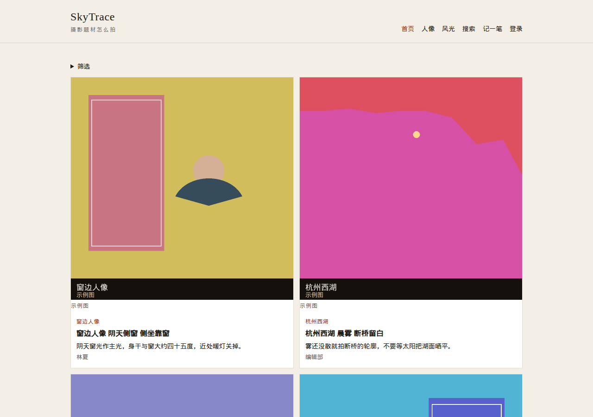
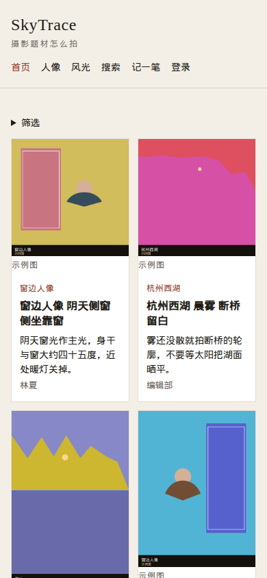
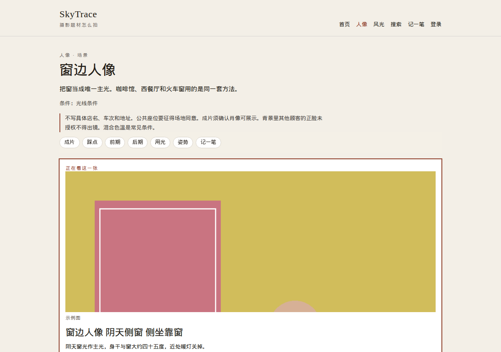
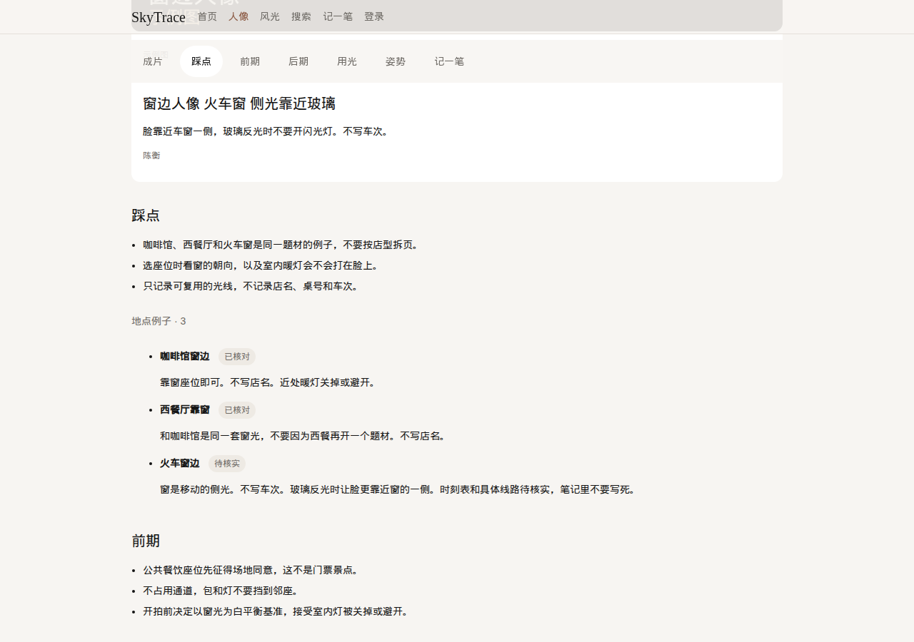
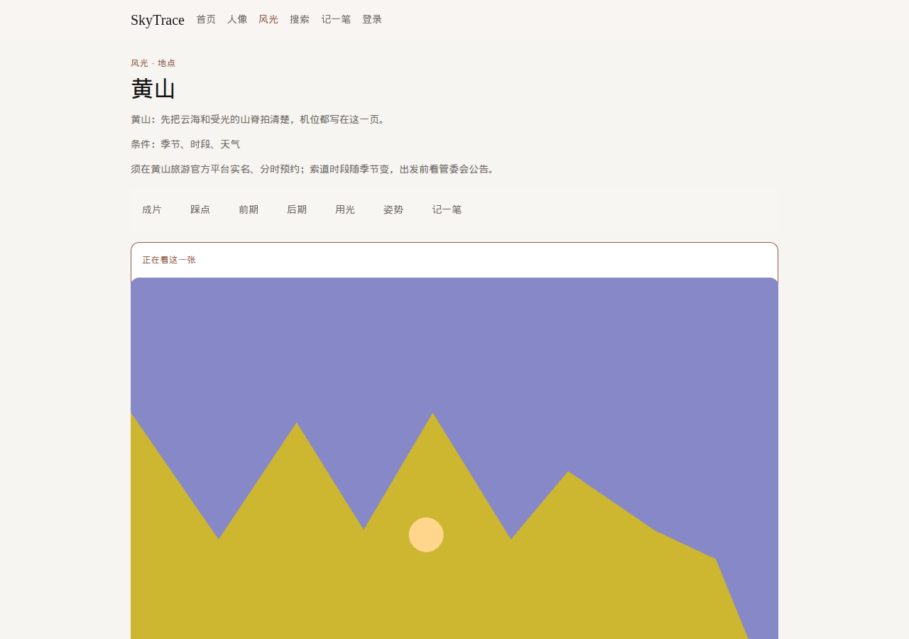
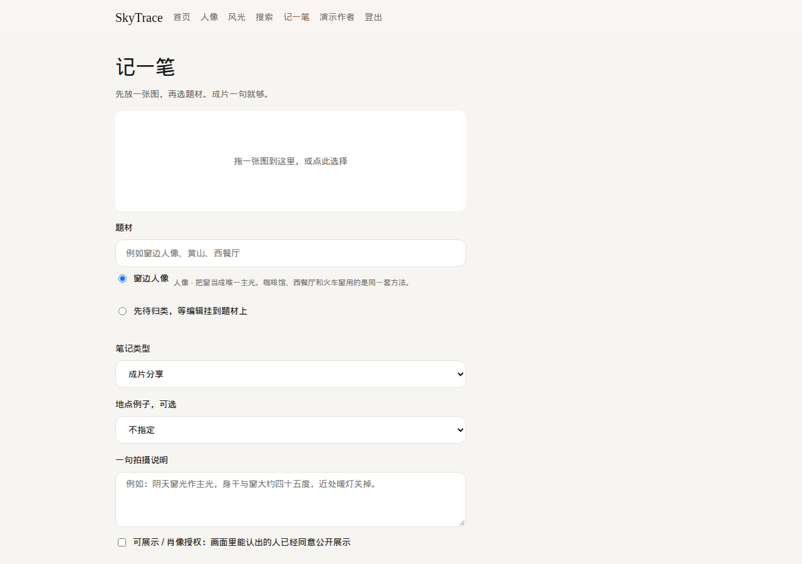
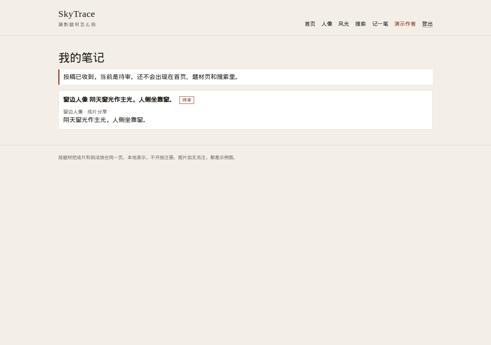
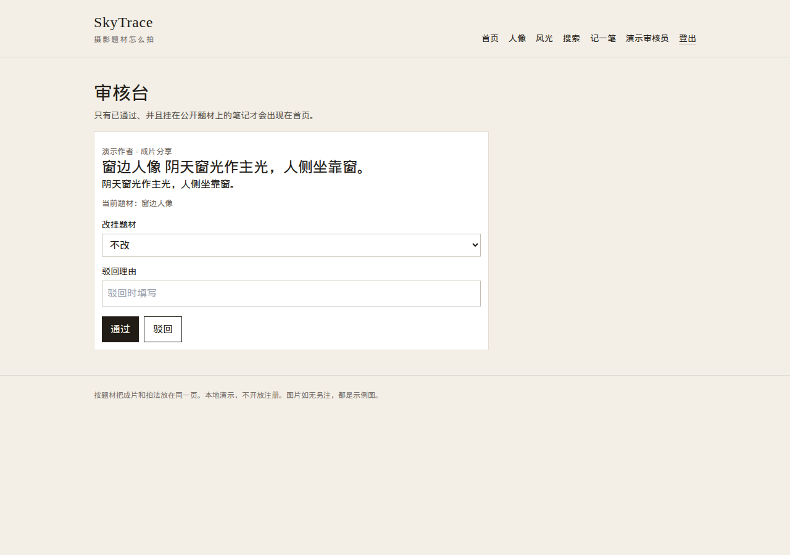

# SkyTrace 演示脚本

给明早看的路径。先跑：

```bash
pip install -e ".[dev]"
python -m app.demo
```

打开 <http://127.0.0.1:8000>。作者 `author@skytrace.local` / `author-demo-pass`，审核员 `reviewer@skytrace.local` / `reviewer-demo-pass`。

图都是程序画的示例图，卡片和题材页上都写了「示例图」。

## 1. 首页先是内容

打开首页。两列图文已经在，人像和风光混在一起。右上角的「筛选」是合上的，不挡图。

每张卡有题材名和一句拍法，不只是一张图。第一屏里能看到窗边人像，也能看到山岳云海日出。文案来自编辑审过的 37 个题材。



窄屏仍是两列：



## 2. 点一张，落到题材页

点一张窗边人像成片。地址是 `/s/window-light-portrait?work=...`，不是单独的作品页。页首写着「正在看这一张」，下面就是这个题材的六段。须知里写着人像要声明展示授权。店规标成灰色「待核实」。

用光：窗光为主光，侧光出立体感。

姿势：侧坐靠窗、手托腮或捧杯。

后期：白平衡按窗光校正，压低环境暖色。



## 3. 踩点里的地点例子

滚到踩点，展开「地点例子」。里面是咖啡馆窗边、西餐厅靠窗座、火车/高铁车窗、居家窗边。不写店名。它们不是导航里的分类。



## 4. 山岳云海日出是同一套结构

回首页，点「山岳云海日出 · 黄山」。还是成片、踩点、前期、后期、用光、姿势。黄山、泰山、峨眉山金顶写在踩点的例子里，黄山标着「待核实」。旧链接 `/s/huangshan` 和 `/s/window-portrait` 会转到新地址。



## 5. 记一笔，然后看到待审

登录作者。点「记一笔」。选窗边人像和成片分享，上传一张图，写一句，勾肖像授权，提交。

「我的笔记」里状态是待审。回首页，这篇还不在。





## 6. 如果要看审核（可选）

换审核员打开审核台，通过刚才那篇。它会出现在首页，也会出现在窗边人像的成片里。

如果有人选了待归类，审核员必须先改挂到一个题材，才能通过。



## 搜索（演示可以不走）

搜「西餐厅」或「火车窗边」，第一条题材是窗边人像。也可以搜黄山、光明顶、黄山云海。
